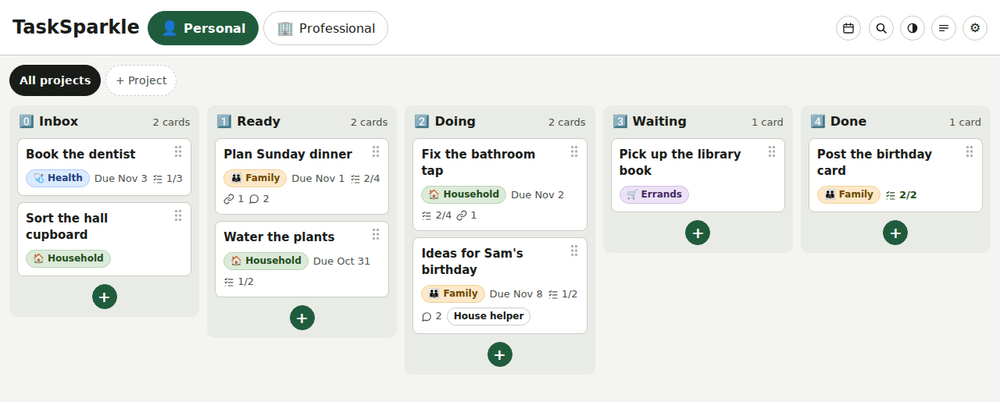
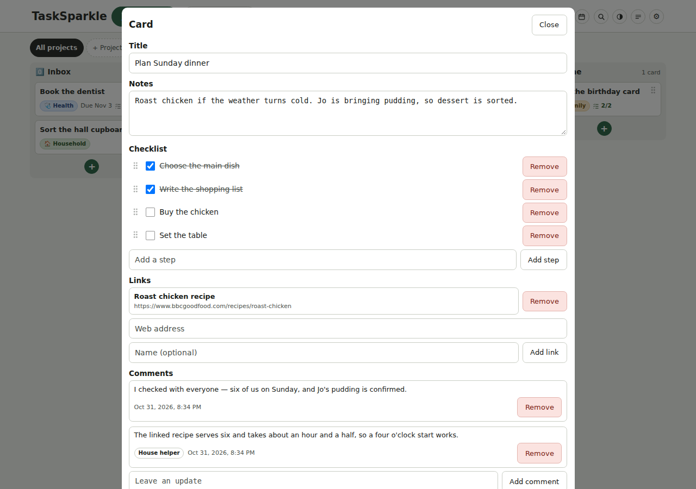
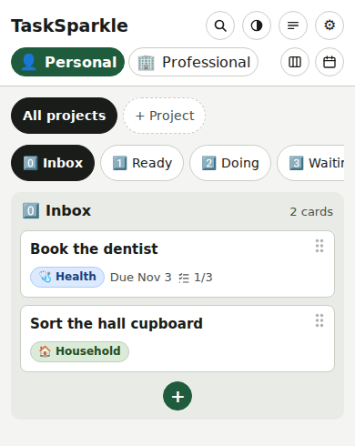

# TaskSparkle

TaskSparkle is a small kanban board you run yourself.

You get boards with columns and cards. Cards carry checklists, links, comments, labels, projects and due dates. It is a website. It runs in a browser, on a computer or a phone. Each person sees only their own boards.

It has an API with personal agent keys. An agent can read, add and move cards. It can tick checklist steps. It can leave progress comments. The API serves its own directions.

Run it on Cloudflare's free tier. Or run it on your own machine. It is MIT licensed; see LICENSE.

*An example board with sample cards. The pill on “Ideas for Sam's birthday” names the key that made the card. A card made by an agent says so on its face.*

*A card open in the editor. Steps tick in place. Comments hold progress updates from the person and their agents.*

*On a phone, columns form a strip. Each card still shows its checklist, comments and maker's tag.*

## What you get

- Boards with columns and cards
- Cards with checklists, links, comments, labels, projects and due dates
- Live updates when a change lands elsewhere
- A Progressive Web App (PWA): install it from the browser on a phone or computer
- Your agent can work your boards through an API with a named key
- Private boards for each person

## Pick a home

### Cloudflare

Your copy lives on the internet. Your boards are there from any device. Nothing runs in your home. The address is HTTPS, so passkeys work there.

You need a free Cloudflare account. You need a domain on that account.

Ship changes two ways. From GitHub, a push to `main` deploys for you. By hand, you run the deploy commands yourself. Both build the same copy.

Start with [Cloudflare setup](docs/cloudflare-setup.md).

### Your own machine

Your copy runs on a machine you own, in your home. Your boards live in one file on that machine. Reaching them away from home is your network's job.

You need no accounts. Each person arrives through an invite link you send them and sets a password, or starts with a passkey. Away from home, Tailscale reaches the copy — and Tailscale Serve gives it an HTTPS address, so passkeys work there too.

Start with [Self-hosting TaskSparkle](docs/self-hosting.md).

### Try it locally

The Cloudflare side has a local run: `wrangler dev` gives a live local copy for reading the code, sign-in included.

## Sign-in and keys

Both ways of running use the same sign-in. It is passkey-first: the sign-in page opens on the passkey, and a password is one tap away as the fallback. The first account is made on the copy's setup page, and that person is the administrator. Everyone after that arrives by a one-use invite link the administrator sends from Settings, then Admin.

On Cloudflare, people and agents use two addresses. On a home copy, both use one address. Either way, an agent reaches the API with a personal key. A key reaches only its owner's boards. The server stores only a key hash. The full key shows once, when made.

The first sign-in makes two empty boards with default labels. It makes no sample cards.

**Cost:** nothing at this size. Cloudflare's free plan covers it. So does a machine you already run. No setup step asks for a card.

## Left out

- Shared boards and collaboration
- An offline mode
- File attachments
- Gantt charts, CalDAV sync and recurring tasks
- A native phone app

## Documents

- [Product spec](docs/spec.md) — what TaskSparkle is, how its parts fit together and what it leaves out

### Run it yourself

- [Cloudflare setup](docs/cloudflare-setup.md) — set up the hosted copy, from GitHub or by hand
- [Self-hosting TaskSparkle](docs/self-hosting.md) — run a copy on a machine in your home

### Use TaskSparkle

- [Use TaskSparkle](docs/using-tasksparkle.md) — boards, cards, settings, phones and agent setup
- [Passkeys and passwords](docs/passkeys-and-passwords.md) — signing in, dropping a password and getting back in

### Agents and code

- [API reference](docs/api.md) — the two doors, agent keys and every API route
- [Watching for changes](docs/watching-for-changes.md) — follow board changes with the version number and state
- [Tests](tests/README.md) — run the API, server and browser drills

### Run the service

- [Operations](docs/operations.md) — repo files, deploys, backups and data recovery

### Project documents

- [README](README.md) — this overview and document map
- [Changelog](CHANGELOG.md) — what each release carries
- [Contributing](CONTRIBUTING.md) — report a problem, send a small fix or plan bigger work
- [Code of conduct](CODE_OF_CONDUCT.md) — the behaviour expected in the project
- [Security](SECURITY.md) — report a security problem in private
- [LICENSE](LICENSE) — the MIT licence
